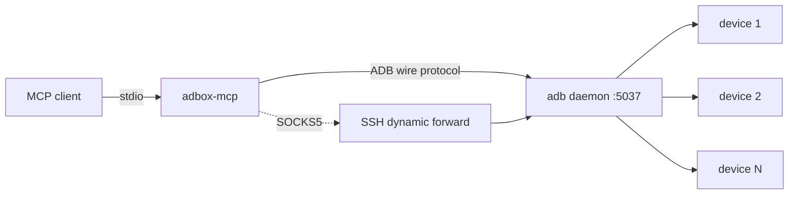

# adbox-mcp

**An MCP server for Android devices that speaks the ADB wire protocol directly — no `adb` binary, no Android SDK, no USB.**

The point is not that it has tools. The point is *where the devices can be*.

Every other Android MCP shells out to a local `adb`:

```ts
import { exec } from 'child_process';
await exec(`adb -s ${serial} shell ${command}`);
```

That pins you to devices attached to the machine the server runs on. An endpoint here
is a `host:port`, optionally behind a SOCKS5 proxy — so a device in a rack, behind NAT,
or at the far end of an SSH tunnel is addressable with the same tools as one on your desk.



---

## Why this exists

| | Typical ADB MCP | adbox-mcp |
|---|---|---|
| Talks to devices via | `exec("adb ...")` | **ADB socket protocol directly** |
| Requires local `adb`/SDK | yes | **no** |
| Remote endpoint | no concept | **`adb=host:port`** |
| Multiple daemons | no concept | **named endpoints, resolved per call** |
| Behind NAT / bastion | not possible | **`proxy=socks5://...`** |
| Binary | Node + npm | **single static Go binary** |

A single 11 MB binary that works from any machine that can open a TCP connection.

---

## Install

```bash
go build -o adbox-mcp .
```

## Use

```bash
# A daemon on this machine
adbox-mcp -endpoint "adb=127.0.0.1:5037,name=desk"

# A daemon across the world, through an SSH SOCKS5 tunnel
ssh -N -D 11080 user@rack-host &
adbox-mcp -endpoint "adb=127.0.0.1:5037,name=rack,proxy=socks5://127.0.0.1:11080"

# Several at once; each call picks its endpoint by the device's address
adbox-mcp \
  -endpoint "adb=127.0.0.1:5037,name=desk" \
  -endpoint "adb=10.0.0.9:5037,name=lab,proxy=socks5://127.0.0.1:11080"
```

MCP client config:

```json
{
  "mcpServers": {
    "adbox": {
      "command": "adbox-mcp",
      "args": ["-endpoint", "adb=127.0.0.1:5037,name=rack,proxy=socks5://127.0.0.1:11080"]
    }
  }
}
```

---

## Tools

### Endpoints

| Tool | Does |
|---|---|
| `endpoints_list` | Every registered daemon, its reachability, and the proxy it uses |
| `endpoints_add` | Register one: `adb=host:port[,name=alias][,proxy=socks5://host:port]` |
| `endpoints_remove` | Drop one by id, alias, or `host:port` |

### Devices

| Tool | Does |
|---|---|
| `devices_list` | Every device on every endpoint: serial, model, state, endpoint |
| `device_info` | Brand, model, Android version, SDK level, battery, physical resolution |

### Acting on one device

| Tool | Does |
|---|---|
| `device_shell` | Run a shell command, return its output, with a timeout |
| `device_input` | `tap`, `swipe`, `text`, or `key` |
| `device_screenshot` | PNG of the current screen, as image content |
| `device_push` | Push a local file over the native sync protocol |
| `device_forward` / `device_forward_list` | Port forwarding rules |

### Addressing a device

`device` accepts three forms, because two racks can hold a device with the same serial:

```
25ac8b272a017ece             serial
25ac8b272a017ece@rack        serial + endpoint alias
25ac8b272a017ece:7@rack      serial + transport id + alias
```

---

## The SOCKS5 detail that matters

`adb forward tcp:N ...` makes the **daemon** open a listening port on **its own host**.
A client that runs elsewhere and then dials `127.0.0.1:N` reaches its own loopback, not
the daemon's — every connection silently goes nowhere.

That is why the proxy is not a convenience here but a correctness requirement: with
`proxy=socks5://...`, every connection the client makes — the control channel and the
forwarded ports — resolves on the daemon's side, where the ports actually are.

---

## Status

Working against a live 20-device lab over an SSH SOCKS5 tunnel:

```
devices_list          20 devices
device_info           SM-N960U1 / Android 10 / sdk 29 / 77% / 1080x1920
device_shell          returns real output with exit status
device_screenshot     121509-byte PNG, 1080x2220
device_input          key events delivered
```

## License

BSD 2-Clause. `internal/adb` is derived from
[zach-klippenstein/goadb](https://github.com/zach-klippenstein/goadb) (BSD 2-Clause,
Copyright 2014 Zach Klippenstein), extended with SOCKS5 dialing and
transport-id-aware device descriptors. See [LICENSE](LICENSE).
